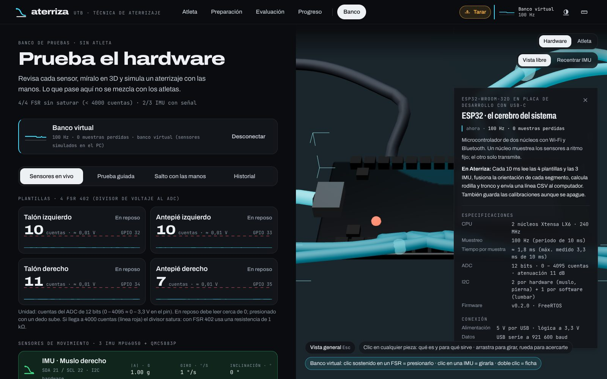
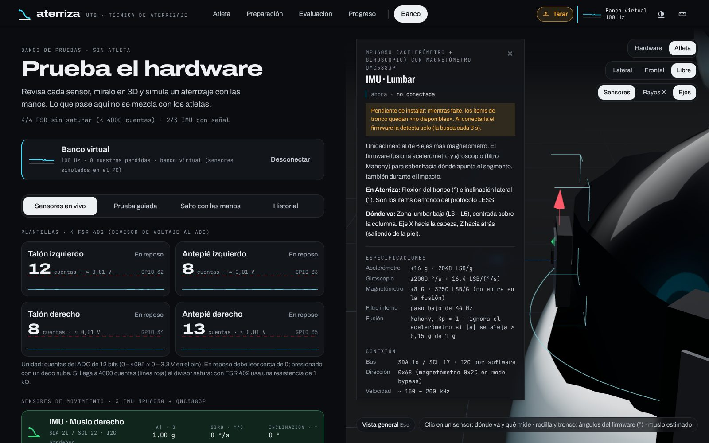
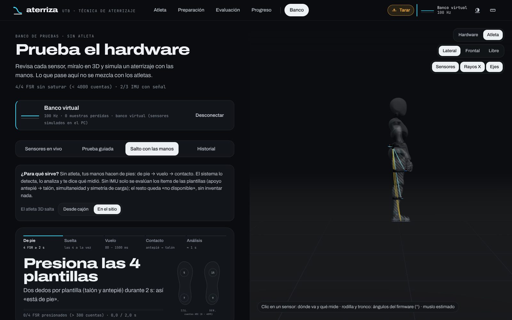
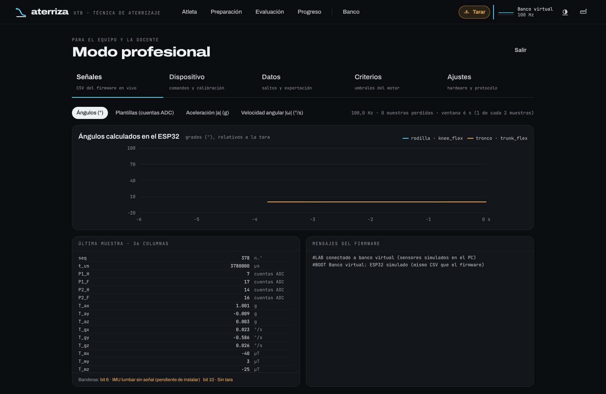

# Aterriza

**Evaluación portátil del aterrizaje del salto.** Dos plantillas instrumentadas y tres IMU
sobre el cuerpo, un ESP32 que muestrea a 100 Hz y una plataforma web que le dice al deportista,
al instante y en lenguaje claro, qué hizo bien, qué corregir y por qué — con un atleta 3D que
reproduce el movimiento medido.

[](https://github.com/AndresGarcia-15/aterriza/actions/workflows/ci.yml)


Proyecto académico de biomecánica deportiva — Universidad Tecnológica de Bolívar (UTB),
Cartagena, Colombia.

<p align="center">
  
  
</p>

> **Herramienta educativa de técnica; no es un diagnóstico médico.** El índice de técnica
> (0 – 100) resume criterios del protocolo LESS; no es un índice de riesgo de lesión.

---

## Qué mide

| Sensor | Dónde va | Qué aporta |
|---|---|---|
| 4 × FSR 402 (2 por plantilla) | Talón y antepié de cada pie | Despegue y contacto (tiempo de vuelo), orden antepié → talón, simultaneidad entre pies, reparto de carga |
| IMU muslo (MPU6050 + QMC5883P) | Cara anterolateral del muslo derecho | Inclinación del muslo → ángulo de rodilla y cadera |
| IMU pierna | Cara anterior de la tibia derecha | Flexión de rodilla y valgo dinámico |
| IMU lumbar *(pendiente de instalar)* | L3 – L5 | Flexión e inclinación lateral del tronco |
| ESP32-WROOM-32D | Cinturón, atrás a la derecha | Muestreo a 100 Hz, fusión Mahony, CSV de 36 columnas por USB a 921 600 baud |

Si falta un sensor, la plataforma lo dice y marca como «no disponible» lo que depende de él:
el índice se calcula solo con lo que sí se midió, sin inventar datos.

## Arquitectura

```
                 ┌──────────────── firmware/ (ESP32, C++) ────────────────┐
 plantillas FSR ─┤ ADC 12 bits · I2C ×3 · filtro Mahony · tara · flags    ├─ CSV 36 col. @100 Hz
 IMU ×3 ─────────┘                                                        │   USB 921 600 baud
                                                                          ▼
 simulacion/  ── gemelo digital (mismo firmware en el PC) · Wokwi ──► plataforma/backend (FastAPI)
                                                                     ├ detección del salto
                                                                     ├ métricas + motor de reglas (rules.yaml)
                                                                     └ SQLite local
                                                                          │ WebSocket 30 Hz
                                                                          ▼
                                                     plataforma/frontend (React + three.js)
                                                     atleta 3D · resultados · banco · modo profesional
```

## Estructura del repositorio

| Carpeta | Qué hay | Documentación |
|---|---|---|
| [`firmware/`](firmware) | Firmware del ESP32 (Arduino IDE / arduino-cli) y sketches de prueba de hardware | [firmware/README.md](firmware/README.md) |
| [`plataforma/`](plataforma) | **Aterriza**: backend FastAPI + interfaz React/three.js | [plataforma/README.md](plataforma/README.md) |
| [`simulacion/`](simulacion) | Gemelo digital del aterrizaje (firmware real compilado para el PC) y proyecto Wokwi | [simulacion/README.md](simulacion/README.md) |
| [`laboratorio/`](laboratorio) | Panel de laboratorio en Dash: en vivo, grabación de ensayos y análisis | [laboratorio/README.md](laboratorio/README.md) |
| [`plataforma/docs/`](plataforma/docs) | Fundamento científico de cada criterio, guía docente y atribuciones | [ciencia.md](plataforma/docs/ciencia.md) |

## Empezar

Funciona en **macOS, Windows y Linux**. Lo único que hay que instalar a mano es
**Node.js 20 o superior**; los scripts de inicio instalan `uv` (Python 3.12 y sus
dependencias) si falta. La demostración no necesita compilador: sus datos vienen en el repo.

| | macOS | Windows | Linux |
|---|---|---|---|
| 1. Node.js | `brew install node` | `winget install OpenJS.NodeJS.LTS` | [nodejs.org](https://nodejs.org/en/download) o tu gestor de paquetes |
| 2. Abrir la plataforma | doble clic en `plataforma/Abrir Aterriza.command` o `./plataforma/iniciar.sh` | doble clic en `plataforma\Abrir Aterriza (Windows).cmd` o `.\plataforma\iniciar.ps1` | `./plataforma/iniciar.sh` |
| Puerto del ESP32 | `/dev/cu.usbserial-…` | `COM3` (driver CP210x o CH340) | `/dev/ttyUSB0` (usuario en el grupo `dialout`) |
| Compilador de C++ *(solo laboratorio y gemelo)* | `xcode-select --install` | `winget install BrechtSanders.WinLibs.POSIX.UCRT` | `sudo apt install g++` |

Se abre <http://127.0.0.1:8000>. Sin hardware se puede usar la **Demostración** (el firmware
real ejecutándose en el gemelo digital) o el **Banco virtual** (sensores simulados que se manejan
con el mouse y el teclado). El ESP32 por USB se detecta solo en los tres sistemas.

Subir el firmware al ESP32 (Arduino IDE 2 en cualquier sistema): ver
[firmware/README.md](firmware/README.md#1-qué-instalar).

## Funciones principales

- **Evaluación guiada:** preparar (conexión, verificación de sensores, tara) → saltar desde el
  cajón de 35 cm o en el sitio → resultado inmediato con lo primero a corregir.
- **Resultado:** índice de técnica, cada criterio con su valor, unidad, meta y su «¿por qué?»
  con la fuente científica, repetición 3D del salto contra un aterrizaje de referencia.
- **Progreso** por atleta y sesión, con exportación a CSV.
- **Banco de pruebas** sin atleta: sensores en vivo, prueba guiada que detecta pines flotantes,
  cables cruzados y divisores que saturan, salto simulado con las manos y un gemelo 3D del
  hardware explorable pieza por pieza.
- **Modo profesional** (con PIN): señales crudas con unidades, comandos y calibración del
  firmware, todos los datos exportables y los umbrales del motor versionados.

<p align="center">
  
  
</p>

## Pruebas

```bash
cd plataforma/backend  && uv run --group dev pytest -q     # motor de reglas, API, banco, puertos
cd plataforma/frontend && npm ci && npm run lint && npm test && npm run build
python simulacion/gemelo/build.py                          # el firmware compila en el gemelo
```

En cada push, GitHub Actions ([`.github/workflows/ci.yml`](.github/workflows/ci.yml)) las corre
en **Ubuntu, macOS y Windows**, y revisa la sintaxis de los scripts de inicio de Windows.

## Datos y privacidad

Los datos de atletas viven solo en el equipo donde corre la plataforma
(`plataforma/backend/data/plataforma.db`) y **nunca** se suben al repositorio; tampoco la
configuración local (PIN) ni los ensayos grabados en `laboratorio/ensayos/`. El PIN por defecto
del modo profesional es `2468`: cámbialo en *Modo profesional → Ajustes*.

## Flujo de trabajo

- `main` siempre funciona (la CI debe pasar).
- Cambios grandes en una rama (`feature/…`, `fix/…`) y Pull Request hacia `main`.
- Mensajes de commit cortos y en presente: `firmware: …`, `plataforma: …`, `simulacion: …`.

## Licencia

Código bajo licencia [MIT](LICENSE). Los recursos de terceros conservan su propia licencia
(el personaje 3D X Bot es de Adobe Mixamo); ver
[plataforma/docs/ATTRIBUTIONS.md](plataforma/docs/ATTRIBUTIONS.md).

Software: Andrés Felipe García Teherán. Hardware, protocolo y documentación: equipo del
Proyecto Biomecánica, UTB.
